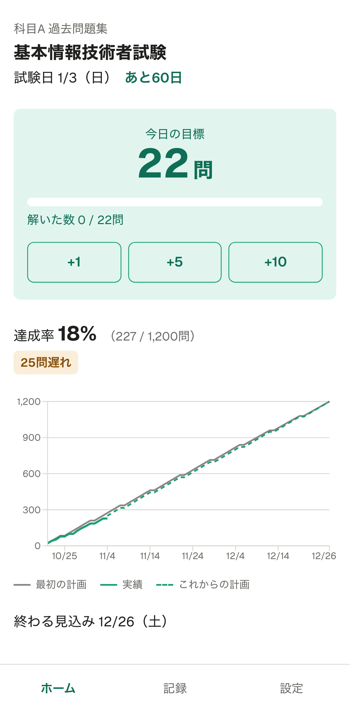

# StudyMap

資格試験の勉強で「1日に何問解けばいいか」「いつ受験すればいいか」を計算し、日々の進捗に合わせて計画を見直せるWebアプリです。

**公開URL**: https://studymap-chi.vercel.app （「サンプルで試す」を押すと、登録なしですぐに中身を見られます）



## 作った理由

問題集や過去問で資格の勉強をするとき、次のようなことで困りがちです。

- 問題集の総問題数は分かっていても、試験日までに1日何問やればいいかを毎回手で計算している
- 反対に「1日これくらいなら続けられる」というペースから、いつ受験するのが現実的か分からない
- 計画を立てても、遅れたときにどれだけ挽回すればいいか分からず、挫折しやすい

StudyMap は、これを計算と記録でまとめて解決します。

## できること

- **計画を作る**: 資格名・問題集・総問題数・周回数・勉強する曜日から、2つの方法で計算する
  - 試験日から：1日に何問解けばいいか
  - 1日のペースから：いつ勉強が終わり、いつ受験できるか
- **無理な日程に気づける**: 1日の上限（初期値50問）を超える日があると「この日程は厳しい」と知らせる
- **毎日の記録**: 「+1」「+5」「+10」ボタンか、合計の数字で記録する。過去の日も直せる
- **計画の立て直し**: 遅れたら残りの日の目標を増やす。進んでいても目標は減らさず、「予定より○日早く終わりそう」と知らせる
- **進捗グラフ**: 最初の計画・実績・これからの計画を1つのグラフで見られる
- **データの書き出し・読み込み**: 計画と記録をファイルに保存し、別の端末や後日に戻せる
- **完了画面**: 全部解き終わったときや試験日を過ぎたときに、振り返りの数字を出す

データはこの端末のブラウザ（localStorage）に保存します。ログインは不要です。

## 使っている技術

- Next.js 16（App Router）、React 19、TypeScript
- Tailwind CSS 4
- React Hook Form ＋ Zod（入力フォームと入力チェック）
- Recharts（進捗グラフ）
- Vitest（計算部分のテスト）、Playwright（画面操作のテスト）
- GitHub Actions（自動チェック）、Lighthouse CI（表示の速さと使いやすさ）
- Vercel（公開）

## 工夫した点

### 計算を画面から切り離してテストした

日付の数え方、1日の目標の配り方、立て直しの計算は、画面と関係のない関数にまとめました（[src/lib](src/lib)）。端数の配り方、勉強しない曜日、予備日、試験日の前後などの境目を、テストで1つずつ確かめています。計算部分は、ほぼすべての行をテストで通しています。

### 立て直しのルールを先に決めた

「遅れたら増やす。進んでいても減らさない」「今日の目標は、記録を入れても今日のうちは変えない」など、迷いやすいルールを先に文書にしてから作りました（[要件定義書](docs/requirements.md)の「再計算のルール」）。

### 入力チェックを1か所にまとめた

入力のルールは Zod の1か所にまとめ、作成画面・計画を変える画面・ファイルの読み込みで同じルールを使っています。間違いは入力欄のすぐ下に理由を出し、間違いがあるうちは先に進めません。

### データを失わないようにした

- 保存したデータが壊れていても自動では消さず、ファイルから読み込み直すか、消すかを選べる
- 新しい計画を作るときも、今の計画は新しい計画を保存するまで残る
- 保存の部分は差し替えやすい形にしてあり、将来クラウド保存に移せる

### 毎回、自動でチェックしている

プルリクエストごとに、次をすべて自動で確かめてから main に取り込んでいます。

- コードの書き方（ESLint・Prettier）と型（TypeScript）
- 計算部分のテストとビルド
- 画面操作のテスト（パソコンとスマホの画面サイズの両方）
- Lighthouse で表示の速さと使いやすさを測り、どちらも90点以上であること

## 開発の進め方

- 要件・画面の仕様・細かいルールは自分で決め、実装は AI（Claude Code）と一緒に進めました
- 決まっていない点が出たら、その都度決めてから文書とコードに反映しました
- 機能ごとにブランチを作り、プルリクエストと自動チェックを通してから main に取り込みました

## ドキュメント

- [要件定義書](docs/requirements.md)
- [開発の手順](docs/roadmap.md)
- [画面設計](docs/design.md)

## 手元で動かす

```bash
npm install
npm run dev
```

ブラウザで http://localhost:3000 を開きます。

テストなどのコマンド:

- `npm test`：計算部分のテスト
- `npm run test:e2e`：画面操作のテスト
- `npm run screenshots`：README の画面の写真を撮り直す

## ライセンス

[MIT](LICENSE)
